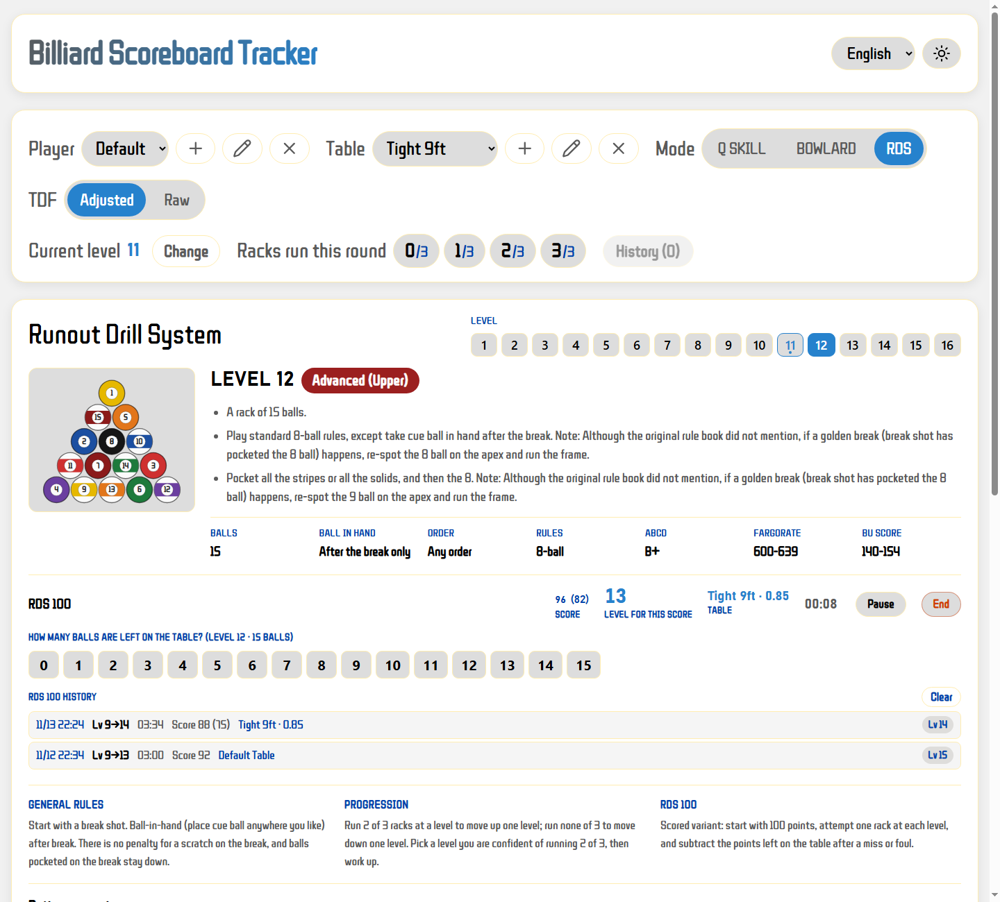
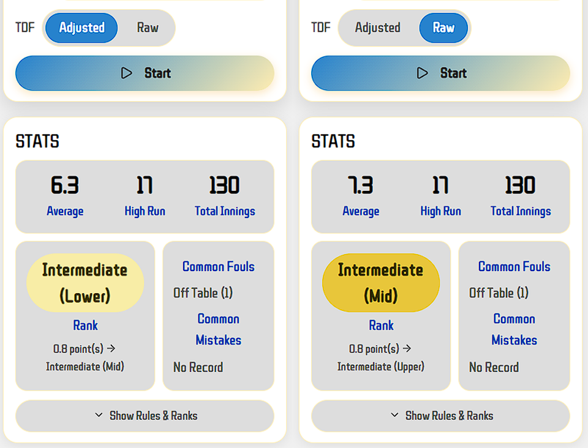

# Billiard Scoreboard

Shield: This work is licensed under a [Creative Commons Attribution-NonCommercial-ShareAlike 4.0 International License](#).

本作品採用[創意共享 署名-非商業性-相同方式共享 4.0 國際版許可證](cc-by-nc-sa)。

[**cc-by-nc-sa**]    http://creativecommons.org/licenses/by-nc-sa/4.0/ 

[**cc-by-nc-sa-image**]    https://licensebuttons.net/l/by-nc-sa/4.0/88x31.png 

[**cc-by-nc-sa-shield**]    https://img.shields.io/badge/License-CC%20BY--NC--SA%204.0-lightgrey.svg 

## Introduction

This work's code was created by AI (Vibe Coding.) As for the text portions, since AI is not very familiar with billiards terminology, and many shittalk, the text can only completed by human. The Japanese translation has not been handled due to lack of time, so the user experience cannot be guaranteed.

此作品之代碼是由AI製作，即所謂「Vibe Coding」。至於文字部份，由於AI對檯球（即撞球、桌球，以下均稱之爲檯球）術語不甚熟悉，而且太多廢話，文字部份只能由人工完成。

此計分器主要針對單人檯球遊戲（練習），目前有以下玩法，：

- Hopkins Q Skill
- Bowlard 
- Runout Drill System (RDS)

支持五種語言，官話（繁簡）、粵語、英語、日語（未完成）。多人玩法由於市面上有大量產品，有心情才會補上。

## 用法說明

### Q Skill

Hopkins Q Skill Challenge 是一套由美國檯球選手 Allen Hopkins 設計的檯球技能評級系統，主要用於評估玩家水平同穩定度。

Hopkins Q Skill Challenge is a billiards skill rating system designed by American pool player Allen Hopkins. It is used to assess a player's individual skill level and consistency. 

#### 簡明規則 (Core Rules)

1. 在腳點上擺放15顆球，母球置於線後。指定袋。
2. 衝球罰分：母球洗袋(-1)，母球離桌(-2)，重新排球(-1)
3. 自由球：衝球後，如果不喜歡當前球型，可移動母球並扣除1分。
4. 前10顆球：每顆1分 | 最後5顆球：每顆2分（需按順序擊打，如在10顆球前入袋，則按1分計算）
5. 10局為1場，最高200分。如未能將球打進指定袋口或犯規，則該局結束。
1. Rack 15 balls on the Foot Spot, cue ball on the Kitchen. Call pocket needed.
2. Break Penalty: Scratch (-1), cue ball Off Table (-2), Re-rack (-1)
3. Ball In Hand: After the break, if player does not like the shot, player can move cue ball with 1 point subtracted.
4. First 10 balls: 1pt each | Last 5 balls: 2pts each (needs to be pocketed in order, if pocket during the first 10 balls, it will be counted as 1pt)
5. 10 innings = 1 session, max 200 points. Innings end if the player failed to pocket a ball into a called pocket or commits a foul.

一場遊戲至少要15至30分鐘。普通的玩家手感差點可能打一整場都未必能碰到後面5顆球，可以選擇Bowlard、RDS或者乾脆不打，少怒氣。

A game last around 15 to 30 minutes. An oridinary player having an off day might not have any chance to play the rotation part in the whole session. Play bowlard or RDS is less frustrating. (Or just sit down and have a tea)

可以只打5局。Shorter session available.

### Bowlard

**Bowlard (亦作 Bowlilard，日語：ボウラード, ボーラード）** 係一種將保齡球計分制度應用到檯球訓練之技能測試。其源自日本，長期被日本職業檯球協會（JPBA）用於職業資格考試的實技部份。雖然理論上可以多人玩，但一場遊戲至少要15至30分鐘（兩人即30至60分鐘），而期間對手不能上場，不適合對戰。

**Bowlard (aka Bowlilard, Japanese: ボウラード, ボーラード)** is a single-player billiards skill test that applies bowling scoring to pool practice. It originated in Japan and has long been used by the Japan Professional Billiards Association (JPBA) in the practical segment of its professional qualification exams. Although, it is possible to play Bowlard as a multiplayer game, since one game last around 15 to 30 minutes (if two player game, 30 to 60 minutes), and the opponent can only sit and watch, so this is not a good game for multiplayer.

#### 簡明規則 (Core Rules)

1. 在腳點上擺放10顆球，母球置於線後。指定袋。
2. 所有球均為1分，可按任意順序擊打。
3. 如玩家在第1桿清檯，為「全中」：得10分，加上隨後2桿的分數。如在第2桿清檯，為「補中」：得10分，加上隨後1桿的分數。
4. 10局為1場，最高300分。每局有2桿。如未能將球打進指定袋口或犯規，則爲1桿。兩桿打完或清檯，該局結束。
5. 第10局 — 每次全中或補中都獲得1次獎勵桿，完成全中或補中後重新擺球。因此本局最多可打3桿。若未取得全中或補中，則與其他局一樣正常結束。

1. Rack 10 balls on the Foot Spot, cue ball on the Kitchen. Call Shot needed.
2. All balls worth 1 point and can be shot in any order.
3. If player clears the table on 1st inning, it is a "Strike", you get 10 points, plus the points from your next 2 innings. If player clears the table on 2nd inning, it is a "Spare", you get 10 points, plus the points from your next inning.
4. 10 frames = 1 session, max 300 points. Player have 2 innings per frames. Innings end if the player failed to pocket a ball into a called pocket or commits a foul. Frame ends after 2 innings are finished or all balls are potted.
5. 10th Frame — Every strike or spare earns one bonus roll, and a new rack is set up whenever a strike or spare is completed. That gives you up to 3 rolls in the frame. If no strike or spare is earned, the frame ends like any other frame. 

#### 補充說明

有兩種記分方式：「單桿」就是一桿進多少球則輸入多少球。「累計」較反直覺，用戶輸入該盤總入球數。此方式中，「0」代表入球數無變化。

### RDS

**Runout Drill System（RDS，清台訓練系統）** 係一套由檯球教練 Dr. Dave 共 Bob Jewett 設計之自適應漸進式訓練系統。其由16 個循序漸進的遊戲組成，其核心目的是令任何水平的選手都可以在「有挑戰性但不怒氣」的區域去練習，並透過升級／降級機制客觀追蹤進步。和其他玩法不同之處是重複性較低，有八球、九球、14.1三種玩法。

**The Runout Drill System (RDS)** is an **adaptive, progressive training system** designed by billiards instructor Dr. Dave in collaboration with Bob Jewett. It consists of **16 challenges of increasing difficulty**. Its core purpose is to keep players of any level practicing in a zone that is "challenging but not frustrating," while objectively tracking improvement through a promotion/demotion mechanism. This system is not as repetitive as it contains 8-ball, 9-ball, Straight pool in the game.

#### 簡明規則 (Core Rules)

RDS 不需要特殊球型擺設，就是「擺球、開球、清檯」。每一局開球後，選手有**自由球（Ball in Hand, BIH）**，可將母球放在檯面任意位置。開球洗袋不罰。部分級別有額外自由球（Extra BIH），以平衡難度。

RDS requires no special setup—just "rack, break, and run." After the break in each rack, the player has **Ball in Hand (BIH)** and may place the cue ball anywhere on the table. No penalty for a scratch on the break.  Some levels grant extra BIHs to balance difficulty.

- **升級／降級機制 (Progression)**：每個等級以 **3 盤**為一組。若在 3 局中成功清台 **2 盤**（過程中無失誤、無犯規），晉級；若只成功 **1 盤**，留級；若 **無清檯**，則降級。
- **Progression**: Each level is played as a set of **3 racks**. If you run **2 out of 3** racks successfully (no miss or foul during the run), you advance to the next level. If you run only **1 of 3**, you stay at the current level. If you run **0 of 3**, you drop to the previous level.

各等級規則詳見網頁。如果不清楚自己水平，建議從6級開始。Use the website to read the rules for each level. If you do not know what your current level, you can start from lvl 6.

#### RDS 100

起始 100 分，每級打一盤，失誤或犯規後按檯上剩餘的球扣分。順便弄的所以比較隨便。

Start with 100 points, attempt one rack at each level, and subtract the points left on the table after a miss or foul.

### TDF

**Table Difficulty Factor（TDF，球桌難度係數）** 是一套由 Dr. Dave 設計的簡易評分系統，用於量化一張檯球檯的難度。只要有球檯尺寸與尾袋大小，就可以計出一個數字，令不同球檯之間有相對客觀的難度對照基準。本頁已自帶一個計算器（頁底），用家可以用此數字調整分數，以更加明確瞭解自己水準。

由於此系統是爲美式（直）袋設計，**不能用來計算英式（圓）袋難度。**一般來說，英式袋比較窄，同等尺寸下比較難入。

The **Table Difficulty Factor (TDF)** is a simple rating system designed by Dr. Dave to quantify how "tough" a pool table plays. It only use table size and corner-pocket geometry, and you can get a number that allows objective difficulty comparisons between different tables. This website contains a simple calculator (buttom of the page), user can use the caculated result to adjust the score, and have a better understanding of his/her level.

Since this system is designed for American-style (straight-cut) pockets, **it cannot be used to calculate the difficulty of English-style (rounded) pockets.** Generally speaking, English-stlye narrower and at the same table/pocket size, it is harder to pot.

## Rating Reference

| BU Score | Player Level                  | ABCD        | Fargo Rating | Q Skill (avg/inning) | Bowlard (avg/session) | RDS Level | ARS (AZ) | 大陸民間 | Description                                                  | 說明                                                         |
| -------- | ----------------------------- | ----------- | ------------ | -------------------- | --------------------- | --------- | -------- | -------- | ------------------------------------------------------------ | ------------------------------------------------------------ |
| 185~200  | World Class 世界級            | A++/AAAA/SS | > 750        |                      |                       | 16        | 10-2     | 11       | Top professional. World class player. Capable of winning major  professional tournaments. Almost always finishes in the money in any  tournament entered. | 頂級職業選手，世界級水平，有能力贏得大型職業賽，參加任何比賽幾乎都能獲獎。 |
| 175~184  | Professional 職業             | A+/AAA/S    | 720~749      | 18.1+                | 210+                  | 15        | 10-1     | 10, 11   | Professional, or player possessing professional skills. Capable of  winning local open tournaments. Usually finishes in the money in regional  tournaments. | 職業選手，能贏得地方公開賽，區域賽通常能獲獎。               |
| 165~174  | Upper Amateur 業餘（上）      | A/AA        | 680~719      | 16.1~18.0            | 180~209               | 14        | 10, 10-1 | 9, 10    | Has professional skills. Can win or place high in local open tournaments. | 具備職業技術，能在地方公開賽奪冠或取得前列。                 |
| 155~164  | Lower Amateur 業餘（下）      | A-/A        | 640~679      | 12.1~16.0            | 140~179               | 13        | 9, 10    | 8, 9     | Competitive amateur who can run several racks in a row.      | 有競技水平的業餘選手，能連續清檯多次。                       |
| 140~154  | Upper Advanced 上級（上）     | B+          | 600~639      | 11.1~12.0            | 127~139               | 12        | 8, 9     | 7, 8     | Very good position play, strategy and consistency. Top league player.  Consistent competitor in local open tournaments. | 走位、策略與穩定性良，頂級地方選手，在地方公開賽有穩定競爭力。 |
| 125~139  | Mid Advanced 上級（中）       | B           | 550~599      | 10.1~11.0            | 114~126               | 11        | 7, 8     | 6, 7     | Good position play, strategy and consistency. Good league player.  Competitive in local open tournaments. | 走位、策略與穩定性好，優秀地方選手，在地方公開賽有一定競爭力。 |
| 110~124  | Lower Advanced 上級（下）     | B-          | 500~549      | 9.1~10.0             | 100~113               | 10        | 7, 8     | 5, 6     | Fair amount of knowledge and experience, but inconsistent in execution.  Average league player. | 有一定智識與經驗，但執行不穩定，普通地方選手。               |
| 95~109   | Upper Intermediate 中級（上） | C+          | 450~499      | 8.1~9.0              | 87~99                 | 9         | 6, 7     | 4, 5     | Has learned quite a few shots, but has a lot to learn about position play  and strategy. Inconsistent. | 學過不少球型，但走位與策略仍需加強，表現不穩定。             |
| 70~94    | Mid Intermediate 中級（中）   | C           | 400~449      | 7.1~8.0              | 74~86                 | 8         | 5, 6     | 3, 4     | Has a grasp of the fundamentals, but does not know much about the physics  of the game. Lower-level league player. | 掌握基本功，但對球理認識不多。                               |
| 55~69    | Lower Intermediate 中級（下） | C-          | 350~399      | 6.1~7.0              | 60~73                 | 7         | 5, 6     | 2, 3     | Very basic knowledge of the fundamentals. Knows almost nothing about  position play. Lowest-level tournament player. | 只懂很基本的概念，幾乎不懂走位。                             |
| 40~54    | Upper Beginner 初級（上）     | D+          | 325~349      | 5.1~6.0              | 50~59                 | 6         | 4, 5     | 2        | Knows little about the fundamentals, but might know a couple of shots.  Average social player. | 對基本功認識不多，只會打簡單的球。。                         |
| 30~39    | Mid Beginner 初級（中）       | D           | 300~324      | 4.1~5.0              | 40~49                 | 5         | 3, 4     | 1        | May not know anything about the fundamentals or making shots.  Non-competitive. | 可能完全不懂基本功，球桿都沒拿穩。                           |
| 20~29    | Lower Beginner 初級（下）     | D-          | 200~299      | 3.1~4.0              | 29~39                 | 4         | 2, 3     | 0        | Knows nothing about the game except maybe a few rules of play. | 除了幾條規則外幾乎不認識這項運動。                           |
| 0~19     | Novice 入門                   | D--         | 0~200        | ~3.0                 | ~29                   | -3        | 1, 2     | 0        | Just start the game.                                         | 剛開始碰球。                                                 |

### 參考 Reference

        <a href="https://yokohama-billiards.com/billiards-susume/rule-boulard">Bowlard [JP/日]</a>

        <a href="https://drdavepoolinfo.com/instructional-articles/pb-review/hopkins-q-skills/">Hopkins Q-Skill [EN/英]</a>

        <a href="https://drdavepoolinfo.com/faq/drill/rds/">Runout Drill System (RDS) [EN/英]</a>

        <a href="https://drdavepoolinfo.com/faq/table/tdf/">Table Difficulty Factor (TDF) [EN/英]</a>

        <a href="https://billiarduniversity.org/testing/ratings/">Score and Rating [EN/英]</a>

        <a href="https://www.fargorate.com/">Fargo Rate [EN/英]</a>

